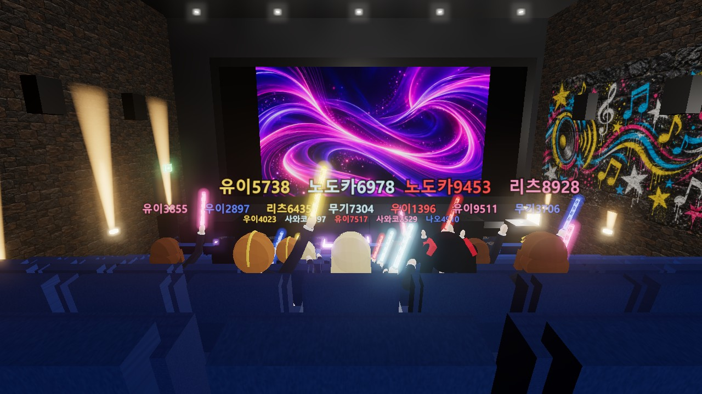
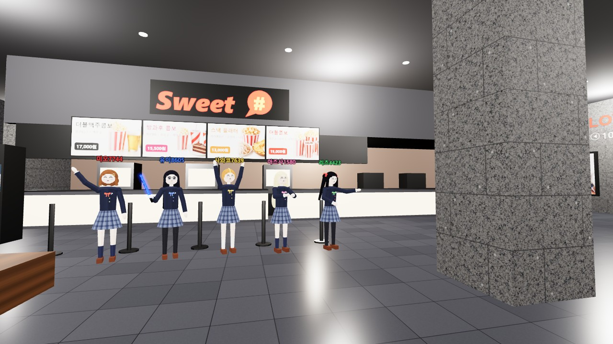
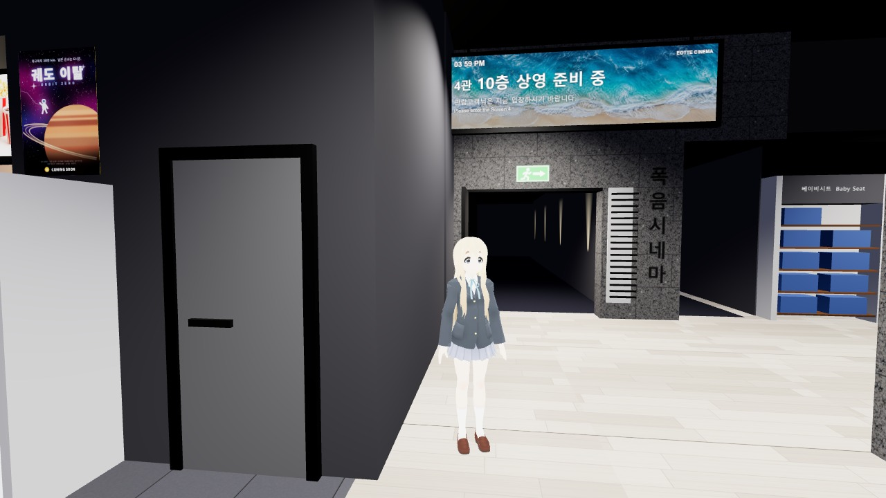
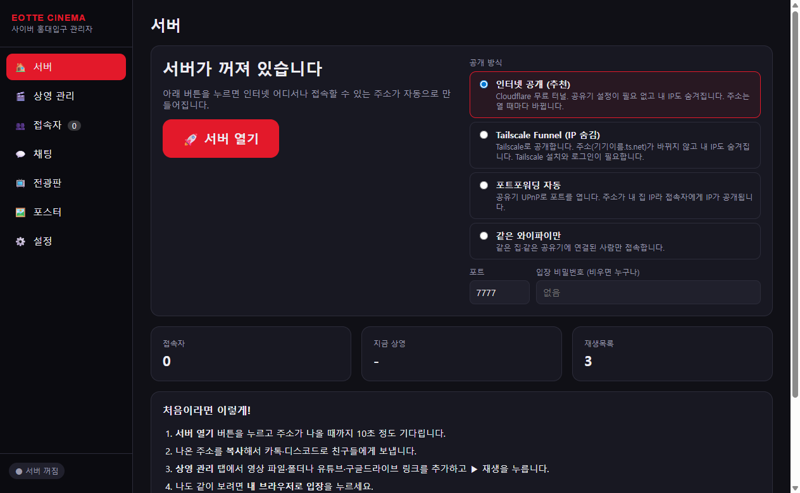
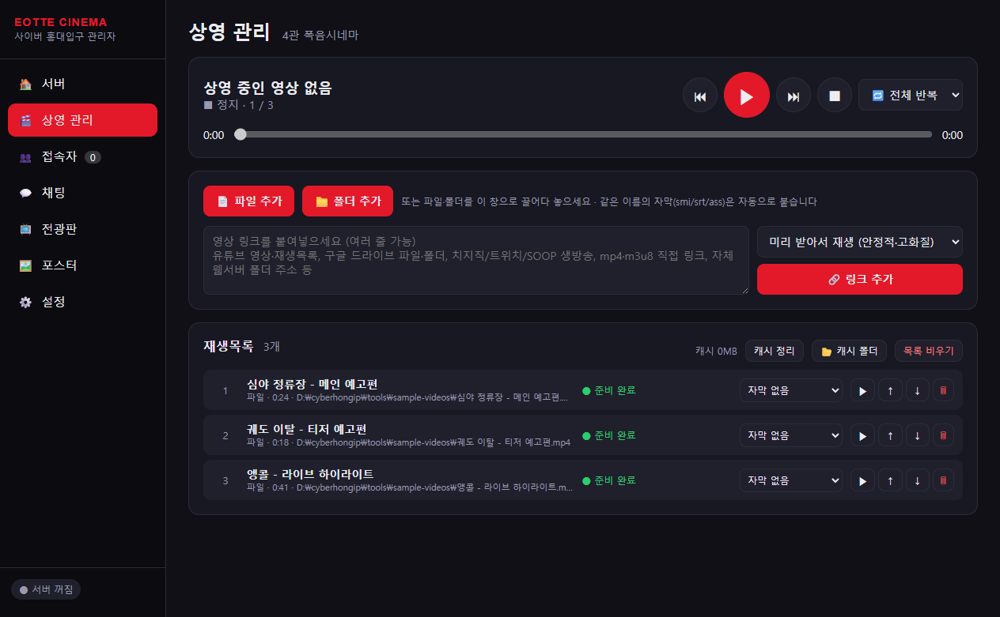

# 🎬 Cyber Hongdae (사이버 홍대입구)

**[한국어 README](README.md)**

A 3D **online watch-party space** that recreates the 10th-floor lobby of LOTTE CINEMA Hongik Univ. (Hongdae) in Seoul and its **Screen 4 "Kwang-eum Cinema"**.

The host opens a server from their own PC with one click. Friends then **just open a link in their browser**, with no install, and walk in as a character. Everyone watches the same movie in sync, chats, waves light sticks and sits in theater seats.



| Lobby | Screen 4 entrance |
|---|---|
|  |  |

| Host dashboard – Server | Host dashboard – Playlist |
|---|---|
|  |  |

---

## ✨ Features

- **3D cinema** built procedurally with a Blender script.
  - **Screen 4**: big screen, purple-LED subwoofer cubes, stone acoustic walls with up-lights, graffiti mural, 187 black leather stadium seats.
  - **Lobby**: snack bar with menu boards, kiosks, window bar, lobby LED wall, poster light boxes, baby-seat shelf, entrances to Screens 5 and 6, restroom.
- **Synchronized playback**: everyone sees the same frame, and late joiners catch up automatically.
- **Almost any video source**
  - Local files and folders.
  - YouTube videos and playlists, Google Drive files and folders.
  - Live streams: Twitch, CHZZK, SOOP, YouTube Live.
  - Direct mp4/m3u8 links, Dropbox links.
  - Self-hosted web server directory listings.
  - Any of the thousands of sites yt-dlp supports.
- **Subtitles**: SMI (CP949 auto-detected), SRT, VTT, ASS/SSA (position, color, alignment). Embedded MKV subtitles and YouTube captions are attached automatically.
- **Automatic transcoding**: formats browsers can't play (HEVC, 10-bit, AC3, AVI, …) are converted with ffmpeg, using NVENC if available.
- **5 original avatars**, made from scratch in code (clean-room), in the K-ON! members' theme colors: Yui red, Mio blue, Ritsu yellow, Mugi pink, Azusa green. You can switch at entry or in settings.
- **Bring your own 3D model**: VRM, GLB/GLTF, FBX, PMX/PMD, OBJ, DAE, 3DS, STL, PLY or ZIP, visible to everyone.
- **Random nicknames** such as `유이3421` or `리츠1346`, assigned on every join to prevent cliques.
- **King-Blade-style light sticks** in 5 colors, with a wave animation.
- **Emotes**: wave, clap, banzai, bow, dance, fighting, air guitar, air drums, and more.
- **Sit in any seat** for an audience point of view.
- **Host dashboard (GUI)**
  - One-click server.
  - Playlist control.
  - Kick, ban and mute; announcements.
  - Lobby LED video; Screen 4 sign text.

---

## 💾 Installation (Windows)

The installer contains **everything**: the host dashboard, the video tools (ffmpeg, yt-dlp) and the tunnel tool (cloudflared). No Node.js or other setup is needed.

1. Go to the **[📥 Releases page](https://github.com/cailet0422/cyber-hongdae/releases/latest)** and download **`CyberHongdae-Setup-x.x.x.exe`** (about 200 MB).
2. Run it.
   - If Windows SmartScreen appears, click **More info → Run anyway**. It appears because the app is not code-signed.
   - Click **Next → Install → Finish**.
3. Start **「사이버 홍대입구 관리자」** (*Cyber Hongdae host*) from the desktop or the Start menu.

Notes:

- No admin rights are required; the app installs into your user folder.
- Data is stored in `%APPDATA%\cyber-hongdae\data`.
- To uninstall, use **Settings → Apps**.
- **Auto-update**: the app checks GitHub Releases on startup and every 6 hours, downloads new versions in the background, and installs them when you close it. To install right away, use the **지금 재시작하고 업데이트** (*restart and update now*) button. To turn this off or check manually, go to **Settings → 프로그램 업데이트** (*program update*).

**From source (developers)**: install Node.js LTS, clone the repo and run `처음 설치.bat` (first-time setup), or build the installer yourself:

```bash
cd app
npm install
node scripts/setup-tools.js
npm run dist
```

---

## 🚀 Opening the server

1. Start **「사이버 홍대입구 관리자」** from the desktop.
2. Pick an exposure mode. The default is fine for a first try.
3. Click **🚀 서버 열기** (*Open server*).
4. After about 10 seconds a public URL appears. Click **📋 주소 복사** (*Copy*) and send it to your friends. A QR code is shown for phones.
5. Click **🎮 내 브라우저로 입장** (*Enter in my browser*) to join yourself.

| Mode | Setup | Address | Your IP exposed? |
|---|---|---|---|
| **Internet (Cloudflare Quick Tunnel)** – default | none | changes every time (`*.trycloudflare.com`) | ❌ hidden |
| **Tailscale Funnel** | Tailscale installed and logged in | **fixed** (`https://<pc>.<tailnet>.ts.net`) | ❌ hidden |
| **Auto port-forward (UPnP)** | router with UPnP | `http://<your-ip>:7777` | ⚠️ yes |
| **Same Wi-Fi only** | none | `http://192.168.x.x:7777` | LAN only |

### Tailscale Funnel (hide your IP, fixed address)

1. Install Tailscale from <https://tailscale.com/download> and log in.
2. In <https://login.tailscale.com/admin/dns>, enable **MagicDNS** and **HTTPS Certificates**.
3. Choose **Tailscale Funnel (IP 숨김)** in the dashboard and open the server.
4. If you see "Funnel is disabled on this tailnet", click **🔗 허용 페이지 열기** (*open approval page*), approve once, and retry.

Funnel runs in the foreground, so closing the server removes the Funnel config automatically. Other Tailscale settings are left untouched. The first free Funnel port among 443, 8443 and 10000 is picked automatically. Viewers do **not** need Tailscale.

---

## 🎞 Playing videos

In the **🎬 상영 관리** (*Playlist*) tab:

- **Add files or folders** with the buttons, or drag and drop. Subtitles with the same base name (`movie.mp4` + `movie.smi`) are attached automatically.
- **Paste links** (one per line) and click **🔗 링크 추가** (*Add link*).
  - *Download first* (default) is the most stable and gives the best quality.
  - *Stream directly* starts instantly. Live streams always use this mode.
- **Playback controls**: play/pause, previous/next, stop, seek bar (moves everyone), and loop mode (all / one / none). Reorder with ↑↓. Double-click a title to rename it. Pick or add a subtitle per item.

## 📺 Signs

- **Screen 4 entrance sign**: hall name, floor, title (auto = currently playing), messages in Korean and English, text color, clock, background image. A live preview is shown.
- **Lobby LED wall**: loops a video, image or link. With nothing selected it shows a poster slideshow and now-playing info.

## 👮 Moderation

- **Users tab**: nickname, avatar, IP, seat and join time, with **Mute chat**, **Kick** and **Ban** (by IP and device). Bans can be lifted from the ban list.
- **Chat tab**: live chat, 📢 announcements, slow mode, disable or clear chat.
- **Settings tab**: server name, max users, max video quality, nickname name pool, light-stick colors.

## 🎮 Viewer controls

| Key | Action |
|---|---|
| WASD / arrows | move (Shift run, Space jump) |
| Mouse drag / wheel | rotate camera / zoom |
| E | sit in the nearest seat / stand up |
| F / C / X | light stick on-off / color / wave |
| G | emotes |
| V | first / third person |
| Enter | chat |
| Esc | settings (avatar, volume, subtitle size, graphics quality, …) |

On phones, use the on-screen joystick and the **E** button. If there is no sound, click the red banner. Browser autoplay policies require one click.

---

## 🧸 Use your own 3D model

Every viewer can **upload their own 3D model and use it as their avatar**, and everyone else sees it too.

**How to upload**

- On the entry screen, click **📂 모델 파일** (*model file*) or **📁 모델 폴더** (*model folder*).
- After joining, use **Esc → Settings → 내 3D 모델** (*my 3D model*).
- Your last model is remembered and re-applied automatically on your next visit.

| Format | Notes |
|---|---|
| **VRM** (0.x / 1.0) | Recommended. Expressions (blink, smile, …) are supported |
| **GLB / GLTF** | Upload GLTF together with its `.bin` and textures, as a folder or ZIP |
| **FBX** | Mixamo, Unity and Blender exports |
| **PMX / PMD** | MMD models. Upload the whole folder so textures are included |
| **OBJ** (+MTL) | Static meshes |
| **DAE**, **3DS**, **STL**, **PLY** | Other formats |
| **ZIP** | Any of the above with textures. Korean and Japanese file names inside the ZIP are handled |

**Humanoid rigs are detected automatically**: VRM humanoid, Mixamo, Unity, Blender, Unreal, 3ds Max Biped, Daz/CC, and MMD (Japanese bone names).

- **With a recognized rig**, walking, running, jumping, sitting in seats, emotes and light sticks work exactly as they do for the built-in avatars.
- **Without a recognized rig**, the model plays its own clips (idle/walk/run) if it has any; otherwise it bounces around.

**Size and facing**: height is normalized to 1.6 m and the facing direction is detected automatically. Both can be adjusted in Settings (*키* = height, *앞뒤 반전* = flip).

**Limits**: 60 MB per file by default (the host can change this) and 500k triangles. Viewers can hide other people's custom models in Settings. The host can reset a user's model or disable custom models from the dashboard.

---

## ❓ Troubleshooting

- **Lag when many people join**: every viewer streams the video from the host PC. 1080p needs about 5 Mbps per viewer, so 30 viewers need about 150 Mbps of upload. Set the max quality to 720p in Settings.
- **"Port already in use"**: change the port, for example to 7778.
- **YouTube fails**: reinstall the latest release, or update yt-dlp in `<install folder>\resources\tools\bin`:

  ```bash
  yt-dlp.exe -U
  ```

- **Headless server** (source install): run `서버만 실행 (GUI 없이).bat`. A local-only web dashboard is available at `http://localhost:7777/admin?token=local-admin`.

## 🛠 For developers

```bash
cd app
npm start                                   # dashboard
node server/standalone.js --port 7777 --expose tunnel|tailscale|upnp|lan --admin-token SECRET
node scripts/bots.js 80 ws://localhost:7777/ws 60   # load test (80 bots ≈ 130 fps on the client)
```

| Part | What it does |
|---|---|
| `app/server/index.js` | HTTP and WebSocket server, video proxy with HLS rewriting |
| `app/server/media.js` | yt-dlp and ffmpeg pipeline |
| `app/server/playback.js` | server-clock synchronized playback |
| `app/server/subtitles.js` | subtitle parsers |
| `app/server/tunnel.js` | Cloudflare, Tailscale Funnel and UPnP exposure |
| `app/client/` | Three.js r168 client, no bundler |
| `app/client/js/procedural-avatar.js` | original avatar generator, using MMD bone names |
| `app/client/js/custom-model.js` | custom model loader (all formats + ZIP) and humanoid rig detection |
| `app/client/js/avatar.js` | rig-agnostic procedural animation |
| `app/blender/build_cinema.py` | map generator (Blender 4.2) |

Rebuild the map:

```bash
cd app/blender
python make_textures.py
python compose_ai.py
blender -b -P build_cinema.py -- --render
```

## 📜 License & notices

- **Code and original assets** (original avatars, map build scripts, generated textures) are released under the [MIT License](LICENSE).
- This is a **non-commercial fan project** and is **not affiliated** with LOTTE Cinema / LOTTE Cultureworks or with the creators and producers of *K-ON!*. "LOTTE CINEMA", "Sweet#", "광음시네마" and *K-ON!* are names and trademarks of their respective owners.
- The movie posters in `poster/` are copyrighted by their respective owners and are used on the poster light boxes in the map.
- Photo and illustration textures (sign backgrounds, graffiti, night city, menu photos, carpet and stone tiles, fictional posters) were generated with OpenAI Codex (gpt-6.1-sol).
- **Libraries**: three.js (MIT), three-vrm (MIT), three-mesh-bvh (MIT), hls.js (Apache-2.0), Express (MIT), ws (MIT), Electron (MIT), iconv-lite (MIT), qrcode (MIT), nat-api (MIT).
- **Tools downloaded at setup time**: ffmpeg (LGPL/GPL), yt-dlp (Unlicense), cloudflared (Apache-2.0), Tailscale.
